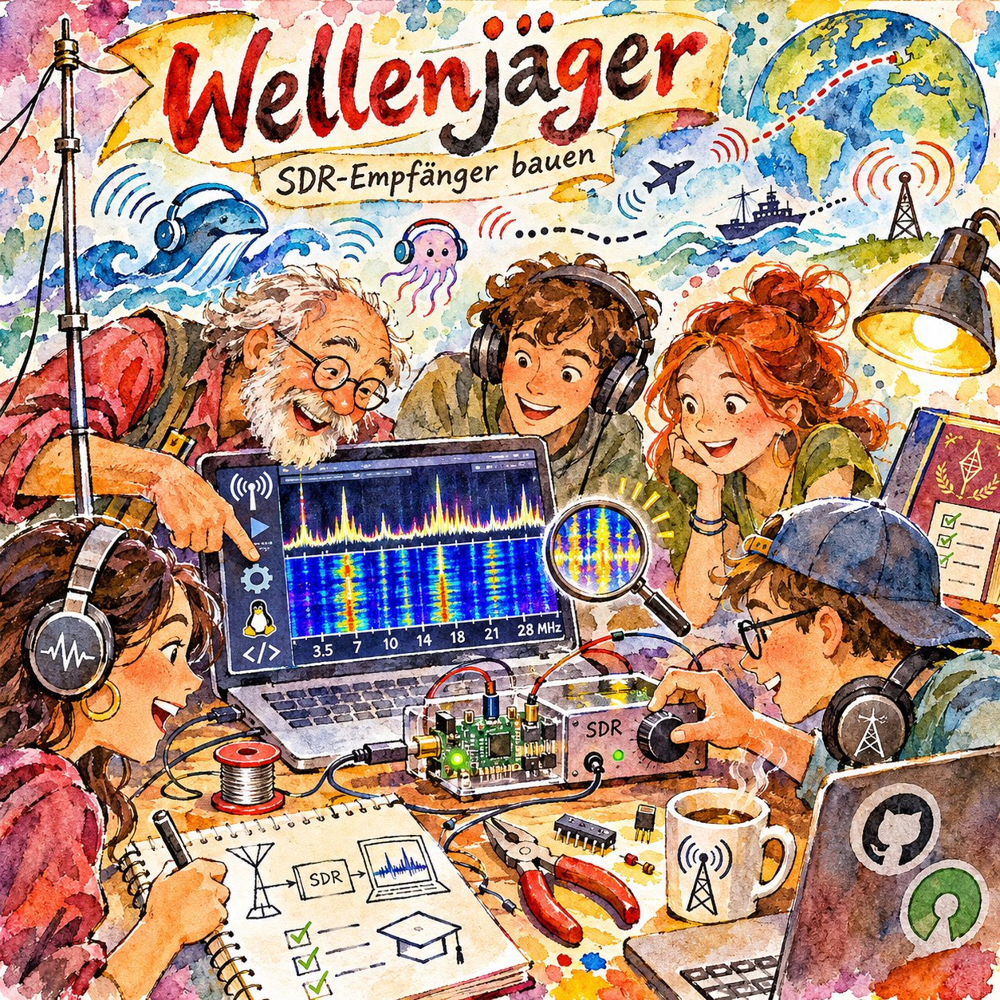

# Wellenjäger: DIY-Kurzwellen-SDR-Empfänger

[Deutsch](README.md) | [English](README.en.md)

*Einen eigenen Software Defined Receiver bauen, die Bänder als Wasserfall sehen und die Signale selbst jagen.*

("Wellenjäger" heisst auf Englisch "wave hunter".)

**Stand: Konzept.** Es gibt noch keine Hardware und keine Firmware. Diese Seite und [docs/konzept.md](docs/konzept.md) sammeln alles, was bisher entschieden ist.

## Was ist das?

Ein Workshop-Projekt für Kandidatinnen und Kandidaten der Amateurfunkprüfung. Gemeinsam bauen wir einen echten SDR-Empfänger für die Kurzwellenbänder, mit offener Software aus bestehenden Projekten. Nur Empfang, deshalb ist für den Betrieb keine Lizenz nötig.

* **Signalweg:** Antenne, Bandfilter, Tayloe-Quadraturmischer, Si5351 als Oszillator, I2S-Audio-Codec, ESP32-S3.
* **Software:** FFT, Wasserfall und SSB/AM/CW-Demodulation auf dem ESP32-S3.
* **Bänder:** Start mit 40 m und 20 m, später 15 m und 10 m. Ein Bandfilter pro Band.
* **Anzeige:** Wasserfall und Spektrum auf dem Gerät und als Webseite vom ESP32 (eigenes WLAN, kein Internet nötig). Bluetooth LE nur als Fernbedienung.
* **Ton:** eingebauter Lautsprecher, 3.5-mm-Buchse mit Line-Out, optional Bluetooth-Lautsprecher.
* **Gehäuse:** 3D-gedruckt, mit Platz für eine Schirmkappe über dem HF-Teil.
* **Robust:** Abnahmekriterium ist ein Falltest aus 1 m auf Holz oder Fliesen.

Kein UKW-Rundfunk: Ein Tayloe-Empfänger deckt etwa 1 bis 30 MHz ab. UKW und MW gibt es im [Funkfüürli](https://github.com/MaShaoDe/Funkfuerli).

## Software-Basis

| Projekt | Lizenz | Plan |
|---|---|---|
| [michalin/easysdr](https://github.com/michalin/easysdr) | GPL-3.0 | als Basis nutzbar, Ableitung muss GPL-3.0 sein |
| [jgauchia/ESP32-SDR](https://github.com/jgauchia/ESP32-SDR) | keine im Repo | Autor fragen, bevor Code übernommen wird |
| [thaaraak/ESP32-A1S-Tayloe](https://github.com/thaaraak/ESP32-A1S-Tayloe) | keine gefunden | Autor fragen, vorerst nur als Referenz |

## Plan

- [x] Konzept und Lizenzprüfung der Software-Vorbilder
- [ ] Autoren von ESP32-SDR und ESP32-A1S-Tayloe wegen der Lizenz anfragen
- [ ] Bandfilter für 40 m und 20 m auslegen
- [ ] Blockschaltbild und Stückliste
- [ ] Platine in KiCad 9 (SMD-Teile im Werk bestückt, Durchsteckteile im Workshop gelötet)
- [ ] Firmware auf Basis von easysdr, Wasserfall und Weboberfläche
- [ ] Gehäuse in OpenSCAD oder FreeCAD
- [ ] Prototyp, Abgleich und I/Q-Balance
- [ ] Workshop-Unterlagen

## Offene Fragen

Siehe die Liste in [docs/konzept.md](docs/konzept.md), Abschnitt "Offene Punkte".

## Lizenz

Hardware CERN-OHL-P-2.0, Dokumentation CC-BY-4.0. Die Firmware folgt ihrem Upstream-Projekt. Siehe [LICENSE.md](LICENSE.md).

73 de Marcel (MaShaoDe)
